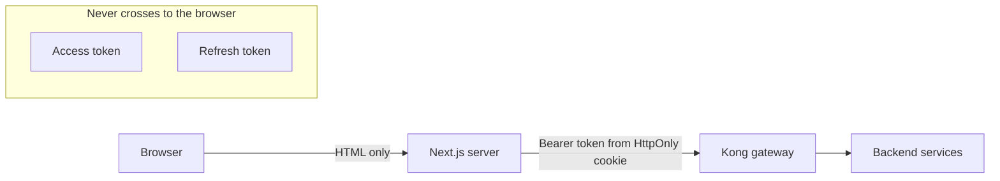
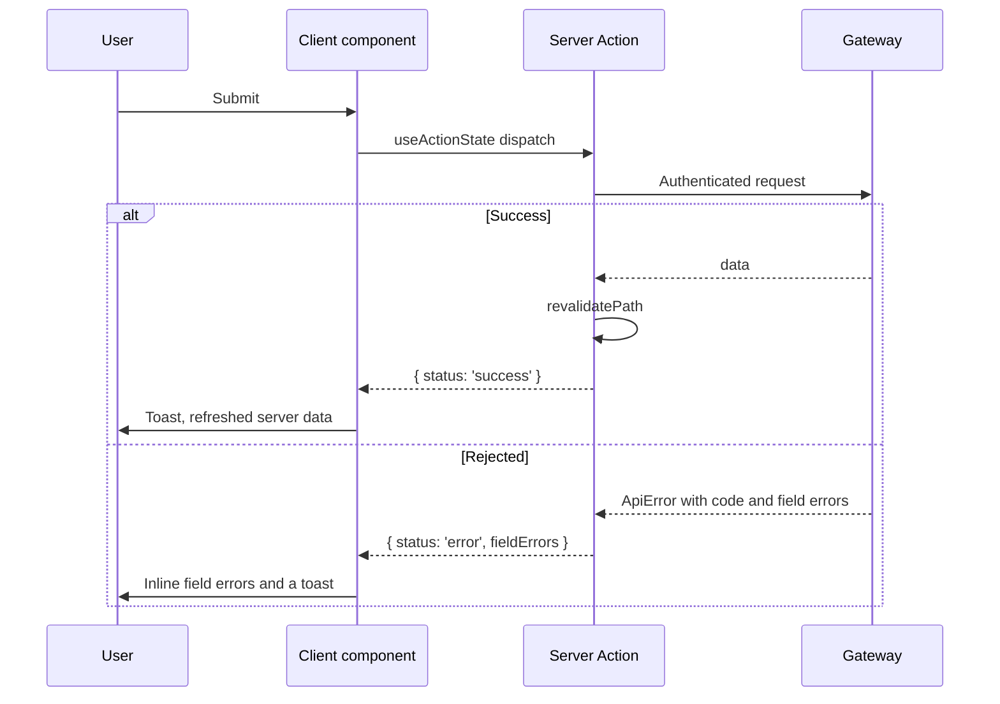

# Frontend architecture

## Rendering strategy

Catalogue pages render on the server and are cached briefly; anything customer-specific is
`force-dynamic` and never cached. Interactivity is a client component only where it is
genuinely needed — quantity steppers, dialogs, filters, toasts.

## Session handling

Tokens live in `HttpOnly` cookies written by the Next.js server. `getAccessToken()` reads
the cookie, decodes the expiry, and rotates the refresh token when the access token is
within 45 seconds of expiring. Cookie writes are only possible in a Server Action or route
handler, so a refresh during a render is used for that request and persisted by the next
action.

The two applications use different cookie names, so a storefront session can never be
replayed against the console.

## Data flow for a mutation

Optimistic updates are used only where being briefly wrong is harmless — the basket
quantity stepper moves immediately and reconciles against the server. Anything touching
stock, money or order state is never optimistic.

## Error handling

`ApiError` carries the machine-readable code, HTTP status, request id and field errors, so
UI code branches on codes rather than parsing messages. Route-level `error.tsx` boundaries
render a recoverable error state and log the digest only — server detail never reaches the
browser.
